# Илья Сляднев

<picture>
  <source media="(prefers-color-scheme: dark)" srcset="images/header-dark.svg">
  <source media="(prefers-color-scheme: light)" srcset="images/header-light.svg">
  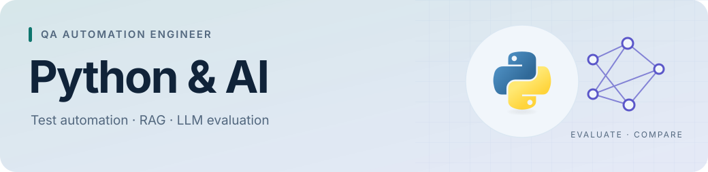
</picture>

**QA Automation Engineer** · Python · AI Evaluation

В этом GitHub собраны мои бенчмарки моделей и отчёты о coding-агентах

[Telegram](https://t.me/ilia_sliadnev) · [LinkedIn](https://www.linkedin.com/in/ilya-sliadnev/) · [GitVerse](https://gitverse.ru/nogamenolife)

## Python и автоматизация

  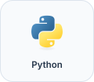
  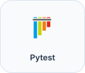
  
  
  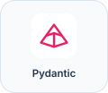

  
  
  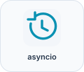
  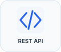
  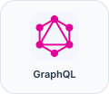
  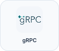

## AI, RAG и evaluation

  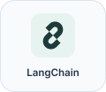
  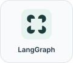
  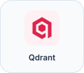
  
  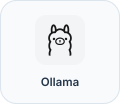
  
  
  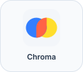

  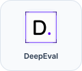
  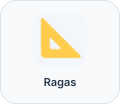
  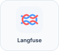
  
  
  

## Инфраструктура

  
  
  
  
  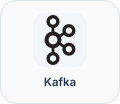
  

  
  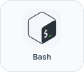
  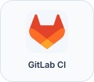
  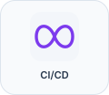
  
  

## Исследования

| Проект | Что внутри |
| :--- | :--- |
| [Ru Embeddings Benchmark](https://github.com/ik-slyadnev/ru-embeddings-benchmark) | Поиск кода по вопросам на русском: 63 конфигурации embedding-моделей и BM25 |
| [Ru Reranker Benchmark](https://github.com/ik-slyadnev/ru-reranker-benchmark) | Сравнение 23 reranker-моделей для поиска кода |
| [Aider Polyglot](https://ik-slyadnev.github.io/aider-polyglot-harness-benchmark/) | Интерактивный отчёт: CLI-агенты, качество решений и расход токенов |
